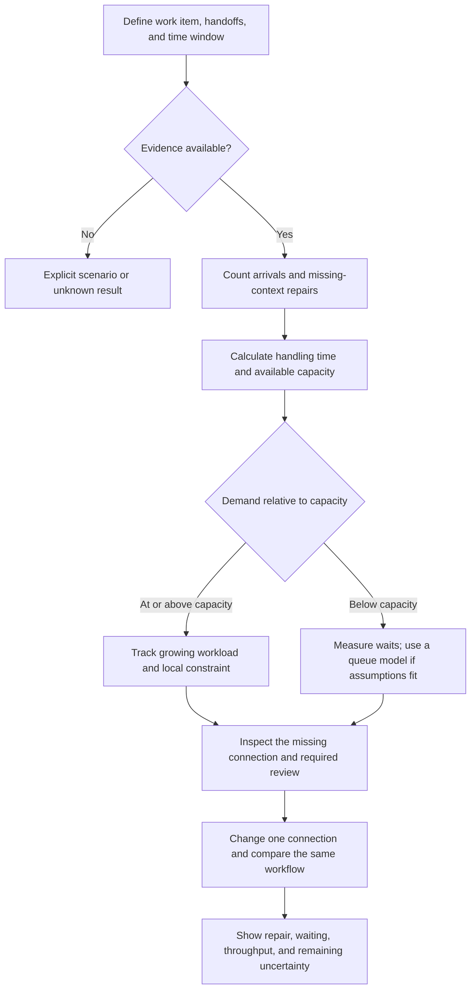

# Visualizer Master

**Friction & Fog: purpose, experience, logic, mathematics, marketing, FAQs, and ecosystem integration**  
**Consolidated:** 6 September 2026  
**Document version:** 1.1  
**Revised:** 6 September 2026, direct explanatory voice and sourced theoretical foundation

The Visualizer is an interactive explanation of how missing operating connections create human repair work, capacity pressure, and stalled delivery. It brings together today's Codex implementation record, the two Visualizer PDFs, the saved questionnaire source, and the current campaign section of `TBTX_MASTER.md`. It replaces reading those separate notes to understand the product. It does not declare an unverified simulator built, deployed, or scientifically validated.

The September 2 campaign section of the ecosystem Master governs names, positioning, department identities, and the public route. Saved source and reproducible calculations establish implementation facts. Later PDF formula changes are identified explicitly. Suggested product behavior and the revised marketing copy below are proposals, not additional approved canon.

## Contents

1. [What the Visualizer is for](#1-what-the-visualizer-is-for)
2. [How it fits the ecosystem](#2-how-it-fits-the-ecosystem)
3. [How the experience works](#3-how-the-experience-works)
4. [The ten department views](#4-the-ten-department-views)
5. [Existing Momentum Map logic](#5-existing-momentum-map-logic)
6. [Theoretical foundation, logic tree, and manifestation formulas](#6-theoretical-foundation-logic-tree-and-manifestation-formulas)
7. [Operational math and a worked example](#7-operational-math-and-a-worked-example)
8. [Data, Context Architecture, and integration](#8-data-context-architecture-and-integration)
9. [Marketing and creative direction](#9-marketing-and-creative-direction)
10. [Ten business-owner FAQs](#10-ten-business-owner-faqs)
11. [What exists and what remains unresolved](#11-what-exists-and-what-remains-unresolved)
12. [The complete saved questionnaire](#12-the-complete-saved-questionnaire)
13. [Source register and consolidation decisions](#13-source-register-and-consolidation-decisions)

## 1. What the Visualizer is for

The Visualizer makes the work between the work visible: finding the current file, reconstructing approval history, reconciling records, identifying the next owner, and checking whether an output reached accepted completion. People can keep a business moving by supplying those missing connections themselves. Delivery can look healthy while that repair consumes their time and attention.

The Visualizer connects that recognizable experience to a specific handoff, an inspectable explanation, and an action. Its useful result is a statement such as: “This approval package arrives without its decision history. Account Management reconstructs it. Linking the approved version, decision owner, and history is the change to test.”

The intended sequence is:

```text
Follow the work
    ↓
Expose the human repair
    ↓
Change one connection
    ↓
Measure what improves
```

### The causal model

Digital Fog is the invisible coordination and gap work people absorb to keep AI-generated work moving. When it accumulates into drag, rework, dropped context, stalled decisions, and lost momentum, it becomes Digital Friction.

AI changes three things together: **quantity**, **speed**, and **flow**. More output arrives faster, and probabilistic, branching work enters operating structures that may not have adapted. “Infrastructure” includes shared context, ownership, decision rights, versions, acceptance criteria, integrations, permissions, and exception handling. It does not simply mean old servers or old software.

A Digital Fog campaign example requires three conditions: AI materially changed quantity, speed, or flow; the infrastructure did not adapt; and a person or department absorbed the gap work. Other process problems can still be investigated, but an inconvenience alone does not establish an AI-created problem.

### Three kinds of information

| Kind | What it establishes | What it does not establish |
| --- | --- | --- |
| Questionnaire answers | What someone reports about how work runs | Measured workload, revenue loss, or failure probability |
| Scenario inputs | What happens inside an explicitly chosen model | A business's actual condition or an achieved improvement |
| Workflow observations | What records show within a defined scope and period | A universal result or causal effect without further comparison |

These distinctions remain visible in the explanation, interface, and saved output. A deterministic formula can reproduce an assumption precisely without making that assumption true.

## 2. How it fits the ecosystem

**Visualizer** is the working name of this explanatory experience. The Scan and the Map retain their separate roles.

| Ecosystem element | Role | Relationship to the Visualizer |
| --- | --- | --- |
| TransformBy10X | Names the condition and creates recognition | Supplies the problem, human story, and campaign language |
| Digital Fog Scan | Public personal experience and routing | Remains distinct; the business model is not silently applied to personal results |
| Momentum Map | Business understanding entry | Supplies reported places to investigate; the Visualizer makes one of those places concrete |
| BizBuilders AI | Operating foundation and implementation | Owns the deeper business explanation and the proposed Visualizer placement |
| BizBlueprint | Translates findings into operating changes | Receives the workflow, gap, evidence, proposed change, and next action |
| Context Architecture | Designs the information, relationships, rules, workflows, and memory work needs | Describes the intervention beneath a proposed improvement |
| FLOW Agent AS / FAAS | Internal governed execution engine | A possible implementation mechanism, not proof that a scenario has been achieved |
| BizBot Mrktng | Growth activation after operating readiness | Follows a foundation capable of supporting follow-through |
| Digital De-Fog Daily | Personal clearing practice | Belongs to the personal route, not the default business remedy |

The business journey is **recognition → Momentum Map → inspect a workflow in the Visualizer → BizBlueprint → aligned infrastructure and governed execution → compare results**. This is the proposed integration sequence. Existing Map routing is recorded in section 5.

### Names and routes

Current names are **Map and Scan**, **BizBlueprint**, **BizBot Mrktng**, **FLOW Agent AS**, and **Digital De-Fog Daily**. The older “See the Fog” stage label is retired. **BizBlueprint** follows the September 2 campaign section and supersedes “AI Biz Blueprint” in older tables.

The campaign Master specifies `/bbai/map` and `/bbai/blueprint` for its business end card. The saved website implementation uses `/tbtx/map`, `/tbtx/blueprint`, and `/bbai`. That difference remains explicit: campaign destination intent is not evidence that a route has been implemented. This document neither changes redirects nor reports these routes freshly tested in production.

The proposed website position is within the BizBuilders AI page after the recognizable operating problem and before the implementation explanation. A completed Map can also hand its context into the same experience. Implementation must preserve the existing Stand journey and verify placement and destinations.

## 3. How the experience works

### The recorded simulator concept

The source conversation progresses from generic sliders to a 15-question business questionnaire, a result profile, a team-size scenario, ten selectable departments, a mapped-gap explanation, and a manifestation whose size follows a formula. It adds an intervention toggle called the “FLOW modifier” and a calculation inspector.

The source's later proposed result screen has two main parts: the Map result and a department scenario. Team size multiplies a preset hours range. Department choice changes the gap explanation and assumed weights. The modifier changes an assumed fragility input. None of those controls measures a workflow by itself.

### The consolidated experience specification

The visual explanation follows a defined work item. This specification is proposed behavior:

| Step | What appears | What the visitor can do |
| --- | --- | --- |
| Recognize | A department and a familiar piece of work | Select a department or arrive from a relevant Map pressure |
| Follow | The deliverable, next handoff, required context, and accepted outcome | Use a clearly labeled sample or describe their own workflow |
| Locate | The missing, conflicting, or hard-to-find connection | Confirm it, reject it, or mark it unknown |
| Expose | Finding, clarifying, reconciling, re-entering, rerouting, or verifying | Identify the repair activity and who performs it by role |
| Quantify | Repair hours, blocked work, and capacity pressure with separate units | Enter observations, estimates, or explicit scenario assumptions |
| Compare | One changed connection and its continuing work | Compare the same workflow and period before and after the assumed change |
| Act | A specific action, owner role, evidence needed, and review date | Leave with a practical next step; continue to BizBlueprint when useful |

Each workflow includes its relevant departments. Ten selectable departments do not imply ten mandatory stages or an enterprise-wide score.

### What the screen needs to explain

The first read answers: **What is getting held up, and what does someone do to move it?** The second shows the selected change and its effect within the scenario. The calculation inspector exposes inputs, units, formula version, assumptions, and rounding. A reader should not have to understand the symbols to understand the problem.

For a workflow display, incoming items move toward accepted completion. Fog gathers at the identified gaps. A blocked item stops at its actual blocker. Selecting it reveals missing context, necessary review, owner role, and evidence. Required review is not automatically depicted as waste.

The manifestation is a visual representation of a disclosed value. Its original 30-foot scale is an artistic convention, not a physical measurement of a company. Zero modeled magnitude stays zero; unknown stays unknown. If artwork reaches its visual limit, the underlying uncapped value and an overflow indication remain available.

### Output from the experience

The proposed portable record contains the workflow and period, reported gap, repair activity, evidence status, calculation inputs and outputs, scenario change, ongoing effort, next action, owner role, review date, and model version. A readable summary and structured export are proposed; the saved implementation record does not establish that either is connected.

## 4. The ten department views

The department view gives the problem a recognizable setting. The following operating examples consolidate today's review. They are investigation prompts, not findings about an actual company.

| Department | Gap and human repair | Connection to investigate | What to compare |
| --- | --- | --- | --- |
| Account Management | Approval history is scattered; someone reconstructs client choices and the current version | One approval record linking version, owner, change history, and decision | Reconstruction minutes and approval cycle time |
| Finance | Scope, authorization, vendor, charge, and invoice records do not reconcile | Shared identifiers and a traceable transaction trail | Exception handling hours and unresolved age |
| Legal | The reviewed version lacks source, rights, or approval evidence | Evidence attached to the reviewed version; material changes reopen the appropriate review | Retrieval effort and returns for missing evidence |
| Production | Approved masters are difficult to distinguish from variants | An approved asset record with status, rights, naming, and delivery requirements | Retrieval time and first-pass acceptance |
| Strategy | Inputs multiply without a clear decision question or retained intent | A decision brief with sources, assumptions, criteria, and accountable decision | Validation effort and avoidable reopened decisions |
| Creative | Feedback and intent separate from the work; selection and revision require reconstruction | Shared brief, approved direction, criteria, and consolidated feedback | Avoidable revision effort and time available for creative work |
| Public Relations | A response waits for current facts or a known approver | Evidence and an explicit approval path by response type | Time to authorized response and missed response windows |
| Media Buying / Planning | Platforms use conflicting objectives, taxonomies, and attribution records | Shared definitions connecting intent, platform action, spend, and evidence | Reconciliation effort and unexplained differences |
| Human Resources | Drafts depend on outdated policy or missing situational context | Versioned policy authority and an appropriate human review path | Verification effort and preventable corrections |
| Operations | Ownership, handoff acceptance, and completion evidence are missing | Accepted ownership, escalation paths, and explicit completion criteria | Orphaned work, handoff age, and verified completions |

### Department identity

The campaign identity system is defined below. The older simulator's hex colors and `DEPT-*` monikers remain historical implementation references; they do not override these identities.

| Department | Campaign code | Moniker | Accent | Diagnostic signal |
| --- | --- | --- | --- | --- |
| Account Management | ACC | The Context Relay | Cobalt | Route-line brackets |
| Finance | FIN | The Reconciliation Loop | Ledger green | Offset closing lines |
| Legal | LGL | The Provenance Chain | Oxblood | Source-mark chain with an unresolved link |
| Production | PRD | The Version Stack | Orange | Stacked frames |
| Strategy | STR | The Signal Filter | Violet | Narrowing signal field |
| Creative | CRT | The Option Field | Magenta | Asterisk field |
| Public Relations | PR | The Approval Pulse | Cyan | Pulse through an approval gate |
| Media Buying / Planning | MED | The Attribution Maze | Chartreuse | Target and route lines |
| Human Resources | HR | The Human Context Check | Coral | Human point inside policy brackets |
| Operations | OPS | The Missing Layer | Brass | Two systems separated by a human-shaped bridge |

Department identity is separate from severity. Legal's accent does not itself mean danger. Legal uncovers missing evidence; Public Relations expresses pressure approaching an approval release. Operations shows the missing connection, not a pileup of all the other departments.

## 5. Existing Momentum Map logic

This section describes the website source saved on September 6, not a fresh production audit. Its logic remains the integration baseline even where an internal label is imperfect.

### Questionnaire and score

There are 15 fixed-order questions, each with four choices worth 0, 1, or 2 points. All questions have equal weight. Section 12 preserves all 60 choices.

$$
a_j\in\{0,1,2\},\qquad S=\sum_{j=1}^{15}a_j,\qquad
h=\operatorname{round}\!\left(\frac{100S}{30}\right)
$$

Here a_j is the stored answer value, S is the raw score from 0 to 30, and h is the rounded score from 0 to 100.

`health` is the saved internal variable name. It denotes an answer-based score, not a measured health percentage, maturity certification, or percentage of momentum recovered.

| Raw score | Configured health band | Profile | Preset hours/person/week | Saved primary destination |
| --- | --- | --- | --- | --- |
| 0–7 | 0–24 | FRAGMENTED | 6–12 | `/tbtx/blueprint?archetype=...` |
| 8–14 | 25–49 | STALLED | 4–8 | `/tbtx/blueprint?archetype=...` |
| 15–22 | 50–74 | SCALING | 2–5 | `/bbai` |
| 23–30 | 75–100 | COMPOUNDING | 1–3 | `/bbai` |

The configured bands label ranges; not every integer within those ranges is reachable with 15 integer answers. For example, S=15 produces health=50 and SCALING.

The saved profile descriptions point respectively to scattered coordination, gaps between steps, opportunities to reduce repeated work, and keeping new AI agents and tools aligned with an already connected setup. All describe what answers suggest, rather than asserting observed performance.

### Places to check

The engine collects mapped pressures for zero-point answers in question order, then one-point answers in question order, and displays the first four. Two-point answers add no pressure. This prioritizes answer values and question order, not measured cost or severity.

| Question | Pressure ID when 0 | Pressure ID when 1 |
| --- | --- | --- |
| 1 | `start` | `handoff` |
| 2 | `next` | `priorities` |
| 3 | `memory` | `scattered` |
| 4 | `tools` | none |
| 5 | `learning` | none |
| 6 | `followup` | `loose-followup` |
| 7 | `ownership` | `informal-owner` |
| 8 | `ai` | none |
| 9 | `decisions` | none |
| 10 | `revenue` | `some-manual` |
| 11 | `repeat` | `sometimes-repeat` |
| 12 | `key-person` | none |
| 13 | `pipeline` | `partial-pipe` |
| 14 | `loop` | none |
| 15 | `shape` | none |

The archetype comes from those four selected pressures, in this precedence order:

1. `key-person`, `ownership`, or `informal-owner` → `bottleneckOperator`.
2. Otherwise `tools` or `handoff` → `toolOverload`.
3. Otherwise `start`, `loop`, or `next` → `executionStall`.
4. Otherwise → `fragmentedWorkflow`.

These stable IDs control routing. Display wording must not replace them as logic. Q5's `learning` is different from Q14's `loop`. Q4=0 means “None yet,” so the internal `toolOverload` label does not prove actual overload. With no pressures, the default can still be `fragmentedWorkflow`; that also does not establish fragmentation.

### Team-hours scenario

$$
[H_{\mathrm{team,low}},H_{\mathrm{team,high}}]
=n\,[H_{\mathrm{profile,low}},H_{\mathrm{profile,high}}]
$$

Here n is the selected number of people; each profile bound is in hours per person per week.

This is a **preset scenario, not time measured by the Map**. It does not change score, profile, pressures, archetype, or route. The saved report starts at one person, exposes 1–20 on its slider, and its helper rounds/clamps supplied counts to 1–50. The simulator proposals use a different initial team size of five; That proposal does not replace the saved site default.

### Saved interaction behavior

`/tbtx/map` renders the shared `DiagnosticEngine` with the business lane inside `StandGate`, using the TBTX report by default. Start Map opens question 1. A selection advances; a previous-question control is available after the first question. The fifteenth answer opens the result. Start Map Again resets the questionnaire.

Answers reside in component state and begin at -1 in the saved website engine. Report derivation treats negative answers as zero, although the normal UI waits until the last selection. Integration should reject incomplete input explicitly rather than treating unknown as a real zero-point response. The inspected question/report files do not submit or persist answers; this is not a site-wide privacy or analytics finding.

## 6. Theoretical foundation, logic tree, and manifestation formulas

### Why more output can produce less movement

Work moves through a network of people, systems, decisions, and handoffs. More AI-generated output can increase both the number of items entering that network and the effort needed to reconcile them. When required context is missing, active handling takes longer. More variable arrivals and handling times produce queues. A constrained approval or repair stage can then limit accepted output downstream.

The explanatory foundation combines **coordination complexity, time-based information overload, queueing theory, conservation of flow, and bottleneck analysis**. Together, these explain how extra coordination can consume capacity and delay completion. They do not derive the existing 1.8 exponent, department weights, 75% modifier, or monster-height scale. Those remain separate choices in the recorded scenario model.

### 6.1 Brooks: the coordination network

For n participants with a possible undirected connection between every pair, the number of distinct connections is:

$$
C(n)=\binom{n}{2}=\frac{n(n-1)}{2}
$$

Five participants have 10 possible pairwise connections; ten have 45; twenty have 190. One additional participant adds n connections to an existing group of n. Brooks discusses this all-to-all coordination burden in *The Mythical Man-Month*. Brooks's Law concerns adding people to a late software project; it is not a universal equation for AI output or organizational failure. [Brooks, *The Mythical Man-Month*, chapter 2, printed page 18](https://www.cs.drexel.edu/~yfcai/CS451/RequiredReadings/MythicalManMonth.pdf)

**Visualizer application:** represent the actual handoff network as G=(V,E), where V contains relevant roles or systems and E contains required connections. Count and inspect actual edges. A defined routing structure can avoid requiring everyone to coordinate with everyone else. Edge count alone does not measure labor: frequency, missing context, and repair time determine the burden at each connection. The quadratic connection count does not justify the scenario's 1.8 power.

### 6.2 Schick, Gordon, and Haka: information overload is a time problem

The temporal approach defines overload in relation to the time demanded by information processing and the time available to perform it. This grounds the distinction between “more information” and “more information than can be handled in the available window.” The publisher's abstract supports that definition; it does not establish the source conversation's claimed universal decision-accuracy cliff. [Schick, Gordon, and Haka, 1990, *Information overload: A temporal approach*, abstract](https://www.sciencedirect.com/science/article/abs/pii/036136829090005F)

A practical accounting expression for this application is:

$$
T_{\mathrm{required}}=\sum_k N_k\bar t_k,\qquad
P_T=\frac{T_{\mathrm{required}}}{T_{\mathrm{available}}}
$$

N_k is the count of a distinct processing activity and t̄_k its mean duration. Both time totals use the same period and units. This is an operationalization for the Visualizer, not an equation quoted from the paper. P_T>1 indicates more required processing time than available time. It does not diagnose a person's cognition, burnout, or intent.

**Visualizer application:** expose the extra finding, checking, and reconciliation work beneath apparently successful delivery. The threshold concerns a defined role, workflow, and window, not a preset label applied to an entire business.

### 6.3 Queueing theory: what happens near capacity

Let λ be mean arrivals per hour, μ mean service capacity in items per hour, and ρ=λ/μ utilization. For an M/M/1 queue with Poisson arrivals, independent exponentially distributed service times, one server, first-come service, and an unlimited waiting area:

$$
\rho=\frac{\lambda}{\mu}<1,\qquad
W_q=\frac{\lambda}{\mu(\mu-\lambda)},\qquad
W=\frac{1}{\mu-\lambda},\qquad
L_q=\frac{\rho^2}{1-\rho}
$$

W_q is mean waiting before service; W includes service; L_q is mean number waiting. Waiting rises sharply as utilization approaches one. The relationship is rational, not exponential. At λ≥μ, this stochastic model has no finite steady-state mean queue. [MIT, *M/M/1 Queue*, page 1](https://ocw.mit.edu/courses/2-854-introduction-to-manufacturing-systems-fall-2016/927056a1af54772a587fd84ad4951e71_MIT2_854F16_Mm1Queue.pdf)

For a hypothetical service rate of six items per working hour, mean service takes ten minutes:

| Arrivals/hour | Utilization | Mean waiting before service |
| --- | ---: | ---: |
| 3.0 | 50% | 10 minutes |
| 4.8 | 80% | 40 minutes |
| 5.4 | 90% | 90 minutes |
| 5.7 | 95% | 190 minutes |

**Visualizer application:** a small remaining capacity margin can matter much more than a linear percentage bar suggests. These illustrative queue values require the stated assumptions; a team with parallel reviewers or scheduled batches needs a suitable model.

### 6.4 Kingman: variation changes the waiting time

Kingman's VUT approximation extends the explanation to a general single-server queue:

$$
W_q\approx
\underbrace{\frac{c_a^2+c_s^2}{2}}_{\text{variability}}
\times\underbrace{\frac{\rho}{1-\rho}}_{\text{utilization}}
\times\underbrace{\tau}_{\text{mean service time}}
$$

Here τ=E[s], ρ=λτ, c_a is the standard deviation of **interarrival times** divided by their mean, and c_s is the standard deviation of service times divided by their mean. The approximation is for a stable single-server queue with appropriate renewal/independence assumptions and finite moments; it is especially motivated by heavy-traffic analysis. [Kingman, 1961, original paper record](https://www.cambridge.org/core/journals/mathematical-proceedings-of-the-cambridge-philosophical-society/article/abs/single-server-queue-in-heavy-traffic/81C55BC00A68FE6D5385638AA0B0AF37), [MIT, *Variation Simulation*, slide 21](https://ocw.mit.edu/courses/16-660j-introduction-to-lean-six-sigma-methods-january-iap-2012/6e340ff4b644ca3e338b5053e0c10710_MIT16_660JIAP12_3-2.pdf)

**Visualizer application:** AI affects arrival volume and burstiness; missing context affects handling duration and variation. At fixed ρ and τ, halving the variability factor halves this approximate waiting time. The relevant data are timestamps and handling durations, not the number of installed AI tools. Kingman's equation supports a nonlinear waiting mechanism, not a universal claim that 10× output creates 100× friction.

### 6.5 Little's Law: connect the visible queue to elapsed time

$$
L=\lambda W
$$

L is average work in the defined system, λ its long-run arrival/throughput rate under balanced flow, and W average time in that system. For the waiting area alone, L_q=λW_q. The quantities must refer to the same boundary, population, and units, with suitable finite long-run averages. Little's Law does not require the M/M/1 arrival and service distributions. [Karl Sigman, Columbia University, *Notes on Little's Law*, pages 1–2](https://www.columbia.edu/~ks20/stochastic-I/stochastic-I-LL.pdf)

For example, an average of 24 comparable items in a stable system completing 12 per working day implies two working days of average time in that system. This is a consistency relation, not proof that adding more work increases throughput.

**Visualizer application:** connect the visible accumulation to observed lead time. The result can explain why a growing stack of unfinished items matters without converting a survey score into an invented delay.

### 6.6 Flow conservation and bottlenecks: the operational physics

For a defined workflow boundary, item accounting gives:

$$
B_{t+1}=B_t+A_t+R_t-C_t-X_t
$$

B is unfinished work, A arrivals, R reopened items, C accepted completions, and X cancellations. Transfers must be added when they cross the boundary. The corresponding rate form, when meaningful, is:

$$
\frac{dB}{dt}=a(t)+r(t)-c(t)-x(t)
$$

This expresses accumulation: work entering faster than it leaves builds unfinished inventory. Item creation, splitting, merging, and cancellation must be accounted for; information itself is not a conserved physical substance.

For a serial workflow in which every item visits every stage once, long-run output is bounded by the slowest effective stage:

$$
\mathrm{Throughput}\leq\min_i\mu_i
$$

An upstream generator becoming faster does not raise downstream accepted output when a different required stage remains constrained. Branching, rework, shared capacity, and different visit counts require a richer network model. [MIT, *Manufacturing Systems Analysis: Flow Lines*](https://ocw.mit.edu/courses/2-852-manufacturing-systems-analysis-spring-2010/00f767946947aca163c372381f8bdaf3_MIT2_852S10_transfer_lines.pdf)

**Visualizer application:** show the relevant bottleneck and follow the queue after an intervention. Moving the queue to another department is different from reducing it. This is the defensible meaning of “operational physics” here: flow, capacity, variability, and accumulation. The sources supply no literal force, mass, energy, or thermodynamic phase-transition model for Digital Fog, Digital Friction, or business momentum.

### 6.7 How the theories connect to the logic tree

The following is a proposed operational calculation path. The existing manifestation code does not yet implement this measurement chain.



The bridge from context repair to queue behavior can be written explicitly. In a simplified workflow, service time consists of necessary handling plus repair when required:

$$
s=s_0+J s_r,\qquad
\tau=E[s]=E[s_0]+pE[s_r\mid J=1]
$$

J is 1 when the specified repair is needed and 0 otherwise; p=P(J=1). Therefore, fewer affected items or shorter repair can reduce mean service time. Measured service variation determines c_s; timestamps determine λ and c_a. Available service capacity then determines utilization. This is an accounting decomposition for the proposed model, not a fitted effect estimate.

| Logic question | Quantity or method | Output used by the Visualizer |
| --- | --- | --- |
| What connects to what? | Actual graph G=(V,E); pair count only as an all-to-all comparison | Required handoffs and missing links |
| What work was added? | N×p×t; observed repair logs | Repair hours and processing demand |
| Can the role handle it? | Required time / available time; λτ for a suitable queue | Capacity pressure at the specified boundary |
| Why is waiting growing? | Observed waits; M/M/1 or Kingman when assumptions fit | Measured or modeled delay, labeled accordingly |
| How much work is accumulating? | Item balance and Little's Law consistency checks | Backlog, age, and elapsed time |
| What constrains accepted output? | Relevant stage capacities and actual dependencies | Local bottleneck and downstream effects |
| What changes after an intervention? | Recalculate changed inputs; compare observations | Net repair reduction, remaining wait, and accepted output |

### 6.8 What the foundation establishes

These relationships explain why disconnected output can consume human capacity and why waiting can increase sharply near a constraint. They give the operational model measurable inputs and testable consequences. The recorded manifestation formula is a separate illustrative mapping: its exponent, normalization, weights, modifier, and height require their own justification or must remain disclosed assumptions. Naming established theories cannot calibrate those constants.

The practical value is the traceable chain from **a missing connection to extra handling, from extra handling to capacity pressure, and from pressure to delayed or blocked work**. That chain makes the proposed intervention explainable and its results testable.

### Recorded manifestation equations

The equations below preserve the recorded arithmetic and identify incompatible revisions.

### Variables and interpretation

| Symbol | Meaning in the proposal | Evidence status |
| --- | --- | --- |
| S | Sum of the 15 stored answer values | Reproducible survey calculation |
| h | Rounded answer score, called `health` in source | Answer-based index |
| O | Assumed output factor | Scenario input or questionnaire-derived proxy, depending on revision |
| I | Assumed fragility factor | Not an empirically established probability |
| u, d | Assigned upstream/downstream department weights | Preset assumptions |
| D | Geometric mean of u and d | Reproducible transformation of assumptions |
| F | Intermediate product used by the curve | Model quantity without a business unit |
| M | Capped manifestation score, formerly called “Momentum Loss” | Scenario index, not a measured percentage loss |
| V | Manifestation height on the 0–30 or older 3–30 scale | Artistic mapping |

The notation uses h for the score and V for height to distinguish the two quantities.

### Department weights in the recorded model

| Department | Code in calculation | u | d |
| --- | --- | ---: | ---: |
| Account Management | AM | 1.2 | 1.5 |
| Finance | FIN | 1.5 | 1.1 |
| Legal | LGL | 1.6 | 1.0 |
| Production | PROD | 1.1 | 1.7 |
| Strategy | STRAT | 1.0 | 1.4 |
| Creative | CRTV | 1.3 | 1.3 |
| Public Relations | PR | 1.4 | 1.2 |
| Media Buying / Planning | MEDIA | 1.2 | 1.4 |
| Human Resources | HR | 1.0 | 1.1 |
| Operations | OPS | 1.8 | 1.8 |

For each department, D=√(u×d). These constants do not encode a measured dependency graph. The source supplies no justified rule for aggregating them into a company-wide result. The calculation codes are historical identifiers, separate from campaign badges.

### A. Original standalone calculation

For two input sliders O_percent and I_percent on a 0–100 scale:

$$
o=\frac{O_{\%}}{100},\qquad i=\frac{I_{\%}}{100},\qquad D=\sqrt{ud}
$$

$$
F=oi,\qquad C=(FD)^{1.8},\qquad
M=\min\!\left(100,\frac{100C}{1.5}\right)
$$

$$
V=3+27\left(\frac{M}{100}\right)\quad\text{feet}
$$

Account Management at 60 and 65 gives F=0.39, D≈1.34164, M≈20.7764, and V≈8.6096 feet. Operations at 90 and 85 reaches the cap: M=100 and V=30. Operations at 90 and 20 gives approximately 8.8 and 5.4 feet.

The original 3-foot intercept produces a creature even when the represented product is zero. Later versions remove it. The earlier widget's displayed 64 and 9.7 feet did not follow this formula: 3+27×0.64=20.28 feet.

### B. Latest reviewed Codex extraction: revision 3

Here a4 and a8 are stored Q4 and Q8 values, not observed output counts:

$$
h=\operatorname{round}\!\left(\frac{100S}{30}\right),\qquad
O=0.2+0.15(a_4+a_8),\qquad I=1-\frac{h}{100}
$$

$$
I_{\mathrm{eff}}=
\begin{cases}
0.25I,&\text{modifier on},\\
I,&\text{modifier off}.
\end{cases}
\qquad D=\sqrt{ud}
$$

$$
F=OI_{\mathrm{eff}}\left(1-\frac{h}{200}\right)
$$

$$
M=
\begin{cases}
0,&I_{\mathrm{eff}}=0,\\
\displaystyle\min\!\left(100,\frac{100}{1.5}[\max(0,FD)]^{1.8}\right),&I_{\mathrm{eff}}>0.
\end{cases}
$$

$$
V=30\left(\frac{M}{100}\right)\quad\text{feet}
$$

For valid questionnaire values, O ranges from 0.2 to 0.8 and I_eff is nonnegative.

### C. Later PDF variant

The nine-page marketing/math PDF and the later code passages in the 204-page PDF change the health multiplier to **(1−h/300)**. Their O formula, `0.2+((a4+a8)/4)×0.6`, is algebraically identical to the 0.15 form above. The PDF version is therefore a distinct recorded variant, not the same equation described by the revision-3 review.

$$
F_{\mathrm{PDF}}=OI_{\mathrm{eff}}\left(1-\frac{h}{300}\right)
$$

The rest of the stated power curve, cap, and 0–30 height mapping remain as above. The counterexample below was independently recalculated; the PDF’s React text has not been verified as a complete application.

### What the calculation checks establish

With all answers zero, Account Management selected, and the modifier off, both later variants produce M≈6.2446. Change only Q4 to 1:

| Quantity | All zero | Q4 becomes 1 |
| --- | ---: | ---: |
| Raw score S | 0 | 1 |
| h | 0 | 3 |
| O | 0.20 | 0.35 |
| I | 1.00 | 0.97 |
| M with h/200 | 6.2446 | 15.7525 |
| M with h/300 | 6.2446 | 15.8968 |

The answer score improves while the assumed volume rises enough to increase the modeled burden. That may be an interpretable scenario if volume truly changes, but the questionnaire has not measured that change. It disproves the source claim that any improved answer guarantees a non-increasing manifestation score. The PDF's claimed reduction to 4.11 is not reproduced by its equation.

For all answers at 2, h=100, I=0, M=0, and V=0, with or without the modifier. That is a model boundary, not proof that a business has no friction.

At fixed O, D, and h below the cap, reducing I to 0.25I multiplies M by `0.25^1.8≈0.08247`. Thus a 75% assumed reduction in I produces approximately a **91.75% reduction in uncapped M**, not a measured 75% business improvement. The cap changes the percentage reduction in the displayed score.

### Interpretation and proposed correction

The exponent 1.8, scale factor 1.5, weights, health complement, and modifier are uncalibrated assumptions in these sources. A power function is not exponential growth. The pair-count expression n(n−1)/2 does not establish repair hours or a business-collapse threshold. The formula contains no measured labor capacity or arrival timing, so it cannot demonstrate a specific human-capacity tipping point.

The proposed correction collects volume independently of the survey. At fixed nonnegative volume and department factor, a scenario proportional to `[O×(1−h/100)×D]^1.8` is non-increasing as h increases, subject to rounding and saturation. This removes that particular input coupling; it does not validate h's complement as fragility. Operational observations remain the stronger foundation for business claims.

For a visual mapped from a disclosed normalized quantity z, `V=30z` is sufficient. Each raw metric and the definition of z remain visible. Repair hours, risk, money, and survey answers should not silently collapse into one apparent measurement.

### Earlier revisions retained as history

| Version | Distinguishing rule | Reason it is not the working specification |
| --- | --- | --- |
| Initial prose | F=O^1.8×I×D; M=min(100,F²/150) | Different formula and unresolved units |
| Buffer-hours widget | Derived repair hours from M and `80−bufferHours`; throughput from `O×(1−M/100)` | No evidential basis for those hours or throughput |
| Early questionnaire conversion | I=max(10,100−3.33S); O=40+15a4+15a8; minimum post-modifier I=5 | Arbitrary conversion and nonzero floor |
| Questionnaire revision 1 | O=min(1,0.3+0.2a4+0.15a8); modifier I=max(0.05,0.25I) | Could add burden to a zero baseline; only five departments in that revision |
| Questionnaire revision 2 | O=0.2+0.05×count(a_j>0); no fragility floor | Restored ten departments and zero; retained survey-volume coupling |
| Questionnaire revision 3 | Q4/Q8 volume factor and h/200 multiplier | Six isolated archetype discrepancies and increasing-score example remain |
| Later PDF | h/300 multiplier | Increasing-score claim still fails; complete build not established |

## 7. Operational math and a worked example

This is the proposed measurement layer. It requires a defined workflow, comparable work items, an explicit time window, and consistent units. It complements the Map; it is not already implemented by the saved simulator.

### Volume and missing context

$$
R_{\mathrm{volume}}=\frac{N_{\mathrm{current}}}{N_{\mathrm{baseline}}},\qquad
\hat p_{\mathrm{missing}}=\frac{n_{\mathrm{missing}}}{n_{\mathrm{examined}}}
$$

N denotes comparable work-item counts; n denotes comparable handoffs. Each denominator must be known and positive.

Variants and accepted deliverables are counted separately. Zero or unknown baseline counts do not yield a usable volume ratio. A handoff is counted once in the overall missing-context rate, even if several required fields are absent; missing-field categories are tracked separately. The rate describes that sample; it is not automatically a universal “Infrastructure Fragility probability.”

### Repair effort

$$
H_{\mathrm{repair,observed}}=\frac{1}{60}\sum_{j=1}^{m}t_j,\qquad
\widehat H_{\mathrm{repair}}=\frac{1}{60}\sum_{k=1}^{K}N_kp_k\bar t_k
$$

In the observed sum, t_j is active repair person-minutes. The estimated sum combines K distinct repair categories.

For each distinct activity k, N is the item count, p the affected fraction from 0 to 1, and t the average active minutes per affected item. Overlapping activities must be reconciled, and the same effort cannot be counted once from logs and again from estimates. Two people in a repair meeting contribute two people's labor but one interval of elapsed time. Necessary review, judgment, and useful client discussion are not automatically repair waste.

### Capacity, backlog, and delivery

$$
H_{\mathrm{req}}=H_{\mathrm{necessary}}+H_{\mathrm{repair}}+H_{\mathrm{other}},\qquad
P=\frac{H_{\mathrm{req}}}{H_{\mathrm{available}}}
$$

$$
G_H=\max(0,H_{\mathrm{req}}-H_{\mathrm{available}}),\qquad
B_{t+1}=B_t+A_t+R_t-C_t-X_t
$$

$$
q_{\mathrm{accepted}}=\frac{C_{\mathrm{accepted}}}{\Delta t},\qquad
r_{\mathrm{miss}}=\frac{N_{\mathrm{missed}}}{N_{\mathrm{due}}}
$$

G_H is the capacity gap in hours. B, A, R, C, and X are backlog, arrivals, reopened items, accepted completions, and cancellations. The throughput period is Δt; N_due counts commitments due in that period.

All capacity terms refer to the same period and scope; shared staff hours are allocated once. Positive demand with zero available capacity is an unavailable-capacity state, not a finite percentage. Pressure above 1 means demand exceeds that specified capacity for that period. A missing permission or deadline mismatch can block work below 1.

Accepted completion must be defined; transfers must be included if they cross the measurement boundary. Reopening an item is different from generating another variant. Blocked elapsed time is the union of each item’s blocked intervals. Reports specify business or calendar hours and include unfinished items and their age. Overlapping waits are not additive project delays.

### Worked weekly scenario

The example contains 120 approval packages per week. Thirty percent need 15 minutes of context reconstruction. Necessary handling is 20 hours; the responsible team has 27 hours allocated to this workflow.

| Calculation | Baseline scenario | Changed-connection scenario |
| --- | ---: | ---: |
| Packages/week | 120 | 120 |
| Share needing reconstruction | 30% | 10% |
| Minutes per affected package | 15 | 5 |
| Repair hours | 120×0.30×15/60 = **9** | 120×0.10×5/60 = **1** |
| Necessary handling hours | 20 | 20 |
| Required hours before new maintenance | **29** | **21** |
| Available role-hours | 27 | 27 |
| Capacity pressure | 29/27 = **1.074** | 21/27 = **0.778** |
| Capacity gap | **2 hours** | **0 hours** |

The repair calculation is:

$$
H_0=\frac{120(0.30)(15)}{60}=9\ \mathrm{h/week},\qquad
H_1=\frac{120(0.10)(5)}{60}=1\ \mathrm{h/week}
$$

$$
\Delta H=H_0-H_1=8\ \mathrm{h/week},\qquad
P_0=\frac{20+9}{27}\approx1.074,\qquad
P_1=\frac{20+1}{27}\approx0.778
$$

The proposed connection links the approved version, decision owner, and change history. The modeled reduction is **8 repair hours per week before maintenance and transition work**. No actual company result is claimed. If the new connection requires two ongoing hours, net modeled capacity released becomes six hours. If it costs more work than it removes, the model must allow a negative result.

### Financial interpretation

$$
\Delta H_{\mathrm{net}}=H_{\mathrm{baseline}}-H_{\mathrm{after}}-H_{\mathrm{new\ ongoing}}
$$

$$
\mathrm{ROI}=\frac{B_{\mathrm{attributable}}-C_{\mathrm{total}}}{C_{\mathrm{total}}},
\qquad C_{\mathrm{total}}>0
$$

B_attributable and C_total use the same monetary units and period. H_after excludes the separately counted new ongoing effort; if that effort is already included, it must not be subtracted again.

Released capacity, realized cash savings, and incremental contribution are different outcomes. The same hours cannot count as both payroll savings and added margin. Zero or unknown intervention costs make that ROI expression unsuitable. Time-value calculations require an explicit rate, period, and explanation of whether spending is actually reduced. This document establishes no realized ROI.

### A first evidence cycle

The proposed evidence cycle starts with one recurring workflow crossing two or three departments. Accepted completion and repair categories are defined before recording baseline arrivals, repair effort, waiting, accepted completions, and quality. One connection then changes. A comparable observation period records staffing, work mix, demand, and deadline changes. A small exploratory sample can improve the logging design; it does not validate a universal effect size.

## 8. Data, Context Architecture, and integration

### The information contract

Every new metric needs its value or explicit unknown state, unit, evidence kind, period, workflow scope, source references, assumptions, and model version. Evidence kinds are **observed**, **self-reported**, **estimated**, and **simulated**. Unknown, zero, and not applicable are separate states.

| Record | Required content |
| --- | --- |
| Survey | Question version, question ID, selected option ID, legacy point value |
| Workflow | Work item, applicable stages, relevant departments, accepted-completion definition |
| Handoff | Sending/receiving stage, owner role, required context, missing context, review state, evidence |
| Event | Work-item ID, event type, timestamp, source, version |
| Repair | Activity category, item/handoff reference, active person-minutes, overlap treatment |
| Review | Reviewed item version, authorized role, decision, timestamp, evidence |
| Scenario | Baseline references, changed inputs, intervention costs, assumptions, calculated outputs |
| Action | Specific change, owner role, expected observable result, review date |

The existing engine stores answer values, so equal-valued options can lose their identity. The proposed integration adds stable option IDs without changing existing score meanings. Older imported responses can retain their score with option identity marked unavailable. All pressures remain in the record even if the screen shows four.

### What Context Architecture changes

Context Architecture connects work to its source, current version, brief, owner, approval decision, acceptance criteria, and next step. Those relationships can be held in an appropriate record or manifest and referenced from the asset. A hash can identify a particular file; it does not prove approval, rights, correctness, or immutability by itself.

The Context Keystones retain their Master's meaning. Their default starting set is **Folders, Markdown, Scripts, Protocols**. They provide structure, written context, repeatable checks, and operating rules. They are supporting implementation concepts, not the opening pitch.

The proposed review behavior checks the applicable requirement against the correct item version and authorized role. A coverage ratio can count completed applicable reviews divided by required applicable reviews, with zero requirements marked not applicable. Coverage does not establish review quality. Checkpoint counts divided by “high-risk nodes” do not establish an enforcement system.

### Website and runtime handoff

The integration specifies a separate Visualizer component and calculation module that consume existing Map context. The recovered partial component is not a verified replacement for the shared `DiagnosticEngine`. Integration needs to preserve question values, stable pressure IDs, profile boundaries, personal/business consumers, Stand gating, result routes, and back/reset behavior.

The handoff into BizBlueprint is the concrete work record: reported issue, observed or estimated repair, changed connection, necessary review, next action, and expected evidence. A proposed FLOW task can reference that record and request a bounded artifact or operating change. A real integration requires a verified accepted job and returned evidence before the interface can report execution success.

The source discussion proposes JSON export, database capture, and an `/api/scan/submit` endpoint. Those are proposals, not recovered working integrations. This source set does not establish a connected database, submission API, live workflow logging pipeline, or deployed Visualizer.

## 9. Marketing and creative direction

### The message

The message leads with the work people want time and attention for, then the coordination consuming that promise. The problem is a missing operating connection. The person handling it is capable, and the proposed solution frees action rather than blaming a department.

The audience is the founder, operator, or department lead who recognizes the recurring repair. The Visualizer earns a deeper conversation by showing how the explanation can be inspected and what could change. It does not need a fabricated loss percentage to make that useful.

### Campaign language retained from the Master

> **AI CREATED A JOB.**  
> **(NOBODY WANTED.)**

> **When AI Outpaces Infrastructure, You Get Digital Fog.**

> **Map the gap. Align the Infra. Build Fog-Free.**

The supporting explanation covers quantity, speed, and flow. “Output outpaces infrastructure” can describe a particular input problem, but it does not replace the broader causal line. “Start Here” remains the hub entrance; “Map Yours” belongs to the business campaign end card. Each surface has one appropriate action.

### Proposed product explanation

AI-generated work still needs a path to completion. When approvals, versions, and decisions arrive disconnected, people supply that path by reconstructing context. The Visualizer follows one piece of work, exposes the repair, and compares a changed connection. The assumptions stay visible, and the result points to a practical next step.

This is draft product copy. It describes the intended experience and is not a testimonial or a claim that an unfinished feature is available.

### Department campaign application

Each department follows the same sequence: a desired benefit, a concrete coordination contradiction, the structural cause, the human outcome, and the route. Each department draws from the work in section 4. Sample numbers from the source conversation, including 47 variations and 300 files, remain illustrative examples unless supported by actual records.

The Master's approved Finance example is:

> **AUTOMATION SAVED EVERYONE TIME.**  
> **(Billing is still trying to find it.)**

The PDF’s “10X production” and “40-hour tax” headline has no supporting measurements in the source set. Public claims about workload and improvement must follow the selected workflow and its evidence. Section 6 explains the applicable flow and queueing relationships; none establishes an inevitable company-wide collapse.

### Visual system and social continuity

The shared field is carbon, warm white, brass, and fog; department accents occupy roughly 12–18% of the campaign frame. Department labels, signals, and human context remain readable across formats. Color does not carry meaning alone.

The Master uses a 12-column campaign grid: diagnosis/type in columns 1–4, person/evidence in 5–12, department badge upper left, campaign lockup lower left. The fracture line connects evidence to diagnosis and does not cross a face. Format-specific crops preserve the person, department indicator, qualifying evidence, and a legible action. These are campaign composition rules, not mandatory layouts for every calculator screen.

Mr. Nobody is the recognizable human introduction. Dr. Drool is the later earned evolution. The sources do not settle whether the 30-foot manifestation is that evolution or a separate visualization; that relationship remains open. Fog reveals the burden around a capable person rather than degrading the person.

The three-second end card follows the Master:

| Time | Beat |
| --- | --- |
| 0.00–0.70 | WHEN AI OUTPACES INFRASTRUCTURE |
| 0.70–1.25 | INFRASTRUCTURE cracks; Digital Fog crosses the line |
| 1.25–1.65 | DIGITAL FOG resolves |
| 1.65–2.10 | FOG transforms into FRICTION |
| 2.10–3.00 | MAP YOURS. |

The intended campaign destination is `/bbai/map`, with `/bbai/blueprint` as the earned next step. Those destinations still need reconciliation with the saved implementation routes. Public use requires verification of readability, mobile interaction, reduced motion, and the actual destination.

## 10. Ten business-owner FAQs

### 1. What is the Visualizer?

The Visualizer is an interactive model of how work moves through a business and where missing context creates extra coordination. It connects a recognizable handoff problem to repair effort, capacity pressure, and a possible operating change. The intended result is a practical next step supported by visible assumptions or evidence.

### 2. What is the difference between Digital Fog and Digital Friction?

Digital Fog is the coordination and gap work people absorb when AI changes the quantity, speed, or flow of work faster than the operating infrastructure adapts. Digital Friction is the resulting drag: repeated work, dropped context, delayed decisions, and stalled delivery. A missing approval history creates reconstruction work; the associated effort and delay show how the two connect.

### 3. What research supports the logic?

The foundation combines Brooks's analysis of coordination overhead, Schick, Gordon, and Haka's time-based definition of information overload, queueing theory, Little's Law, and bottleneck analysis. These explain how added handling consumes capacity and why waiting can rise sharply near a constraint. Section 6 provides the equations, assumptions, sources, and their connection to the logic tree. The current monster formula uses additional illustrative constants that these theories do not independently validate.

### 4. What does the monster's height mean?

Height is a visual mapping of a scenario index. In the later model, a score of 50 maps to 15 feet and a score of 100 maps to 30 feet. Reaching 30 feet means the configured display has reached its maximum; it does not establish a measured loss percentage or a complete business shutdown. Repair hours, waiting time, and accepted output require their own measurements.

### 5. How is the coordination-hours range calculated?

The saved Momentum Map assigns a preset range to each answer profile: 6–12, 4–8, 2–5, or 1–3 hours per person per week. Team size multiplies the range. This is an illustrative allocation scenario, not an established benchmark. A workflow-specific estimate instead uses item count × affected share × repair minutes ÷ 60, or sums recorded repair time.

### 6. What data makes the model specific to a business?

A defined workflow and observation period; arrival and completion counts; the context required at each handoff; missing-context cases; active repair time; available role-hours; and blocked intervals. Arrival and handling timestamps support analysis of variation and waiting. Unknown inputs remain unknown. The saved questionnaire keeps answers in component state; persistent capture and external Visualizer integrations remain proposed.

### 7. What does Context Architecture change?

Context Architecture connects work to the information needed for the next action: source, current version, decision history, ownership, review requirements, and acceptance criteria. A change might link an approval decision to the exact asset version so that the next department no longer reconstructs it. The result is evaluated through repair effort and delivery evidence, rather than assumed from the presence of a metadata file.

### 8. Does the FLOW modifier deploy automation or remove human oversight?

The recorded modifier is a simulation control. It multiplies an assumed fragility factor by 0.25 and recalculates the illustration. It neither deploys FLOW nor proves a reduction in work. Required review and human judgment remain part of the proposed operating design. Actual execution requires a connected implementation and evidence that the relevant work and reviews occurred.

### 9. Does released capacity mean cash savings or more revenue?

Released capacity is time available for other work. Cash savings require an actual reduction in spending; additional contribution requires profitable work that is completed because the capacity became available. Implementation and ongoing costs also count. The same hours cannot be counted twice as both payroll savings and additional margin.

### 10. How does the Visualizer connect to the Scan, Map, and BizBlueprint?

The Digital Fog Scan serves the personal/public route. The Momentum Map is the business understanding entry. The Visualizer adds a concrete explanation of a business handoff, its repair burden, and a change to investigate. BizBlueprint can translate that finding into operating design and implementation scope. FLOW and growth activation follow where the work requires them.

## 11. What exists and what remains unresolved

| Item | Evidence-supported state |
| --- | --- |
| This master document | Written synthesis of the listed sources, with current nomenclature and explicit revision differences |
| Existing Map | Six saved website source files, complete question extraction, scoring, and routing logic |
| Model concept | Department scenarios, UI descriptions, formulas, marketing material, and FAQs recovered |
| Revision-3 arithmetic | Reproducible extraction and audit; rerun during this consolidation |
| Later PDF arithmetic | h/300 counterexample independently recalculated during this consolidation |
| Complete Visualizer application | Not established by the source set |
| Local build, browser interaction, site integration, deployment | Not established for the Visualizer |
| Empirical calibration or business ROI | Not established |
| Database, exports, submission API, FLOW task connection | Proposed, not verified as connected |

The revision-3 audit confirms 15 question texts, all 60 options/values, eight profile boundary cases, ten departments, and the corrected zero boundary. It also reproduces six archetype mismatches across 30 isolated-answer cases: Q2=1, Q5=0, Q6=1, Q8=0, Q10=1, and Q11=1, with all other answers at 2. Q14=0 is corrected in that revision. Those 30 cases are not an exhaustive test of all answer combinations.

The saved file named `Diagnotic Engine.jsx` stops during pressure-list construction. It is incomplete and also contains TypeScript syntax despite its `.jsx` extension. The longer PDF contains more code, but extracted text is not a verified buildable component. Claims such as “merged canonical standard,” “100% canon lock,” and “production-ready” inside the captured answers do not establish those project states.

Implementation acceptance requires correct stable-ID routing, explicit incomplete/unknown handling, inspectable formulas matching the running calculation, separate scenario inputs, coherent units and accounting, all ten department views, and preserved existing routes and consumers. Browser checks then cover the complete journey, keyboard operation, mobile layout, reduced motion, back/reset behavior, and exports or integrations actually included in scope.

The open decisions are specific: the final visual metric and normalization; whether any uncalibrated composite score is worth retaining; the manifestation's relationship to the character story; the implemented route mapping; and which workflow supplies the first evidence. They do not prevent this document from explaining the recovered concept and its logic.

## 12. The complete saved questionnaire

The source questions and option values are preserved below. Each cell lists the original option text followed by its stored points. This records existing behavior, not an endorsement of the questionnaire as a validated business instrument.

| # | Question | Choice 1 | Choice 2 | Choice 3 | Choice 4 |
| --- | --- | --- | --- | --- | --- |
| 1 | Where does your business lose momentum most often? | Starting things **(0)** | Switching between tools **(1)** | Waiting on others **(1)** | Finishing **(2)** |
| 2 | How does your team know what to work on next? | We figure it out as we go **(0)** | We have informal priorities **(1)** | We've got a system, but it isn't always followed **(1)** | We have a clear routing process **(2)** |
| 3 | Where does your team keep the knowledge it needs? | In people's heads **(0)** | In scattered docs and chats **(0)** | In a loosely organized system **(1)** | In a structured, accessible system **(2)** |
| 4 | How many AI agents and tools do you use? | None yet **(0)** | One or two, lightly **(1)** | Several, but they aren't connected **(1)** | Several, connected and producing consistent output **(2)** |
| 5 | When a project ends, what happens to what was learned? | It disappears with the project **(0)** | Some notes get saved somewhere **(1)** | We debrief but nothing formal **(1)** | We capture it and it improves future work **(2)** |
| 6 | How does your business handle missed leads or unanswered inquiries? | They usually fall through the cracks **(0)** | We follow up manually when we remember **(0)** | We have a loose process **(1)** | We have automated follow-up **(2)** |
| 7 | How clear is ownership when something needs to get done? | Unclear - it often falls through **(0)** | It depends on who is available **(1)** | We have informal ownership **(1)** | Every task has a clear owner and routing rule **(2)** |
| 8 | How do AI agents and tools fit into your work? | Experimenting with no system **(0)** | Using tools but results are inconsistent **(1)** | Running workflows but they are fragmented **(1)** | Using AI agents and tools with clear rules and oversight **(2)** |
| 9 | How does your business make decisions under pressure? | Whoever speaks loudest **(0)** | By whoever is available **(0)** | Using loose guidelines **(1)** | Using documented decision rules **(2)** |
| 10 | How much of your revenue depends on manual follow-up or human memory? | Almost all of it **(0)** | Most of it **(0)** | Some of it **(1)** | Very little - systems handle most of it **(2)** |
| 11 | How often does your team repeat work that has already been done? | Frequently **(0)** | Often **(0)** | Sometimes **(1)** | Rarely - we have reusable systems **(2)** |
| 12 | What happens when a key person is unavailable? | Work stops **(0)** | Things slow down significantly **(0)** | We manage, but it's painful **(1)** | The system continues without disruption **(2)** |
| 13 | How visible is your pipeline or lead flow at any given moment? | Not visible at all **(0)** | Partially visible **(1)** | Mostly visible **(1)** | Fully visible with real-time tracking **(2)** |
| 14 | How does your business improve from what it executes? | It doesn't **(0)** | Informally, through conversation **(1)** | We review occasionally **(1)** | We review results and update how we work **(2)** |
| 15 | Which word best describes how work runs today? | Chaos **(0)** | Reactive **(0)** | Building **(1)** | Compounding **(2)** |

## 13. Source register and consolidation decisions

The document consolidates the substance of the source files. Repeated exports do not create additional authority. The three folders named `friction-fog-implementation-record`, `friction-fog-implementation-record 2`, and `friction-fog-implementation-record 3` contain the same 36 non-Finder-metadata files, verified by relative paths and SHA-256 hashes during this consolidation. The numerical suffix does not indicate a newer model.

| Source | Contribution |
| --- | --- |
| [TBTX_MASTER.md](</Users/test/Documents/TBTX_COMMAND_CENTER/Campaign elements/03_CAMPAIGN/08-dm-assets/BBAI/TBTX_MASTER.md>) | September 2 campaign precedence, current naming, department identities, character continuity, marketing, and intended ecosystem routes |
| [Today's implementation record](</Users/test/Documents/Codex/2026-09-06/rev/outputs/friction-fog-implementation-record/README.md>) | Scope, chronology, evidence boundaries, and source inventory |
| [IMPLEMENTATION.md](</Users/test/Documents/Codex/2026-09-06/rev/outputs/friction-fog-implementation-record/IMPLEMENTATION.md>) | Workflow journey, data contract, intervention, integration, and acceptance conditions |
| [FORMULAS.md](</Users/test/Documents/Codex/2026-09-06/rev/outputs/friction-fog-implementation-record/FORMULAS.md>) | Survey, revision history, operational accounting, scenario math, and visual rules |
| [Revision 2 review](</Users/test/Documents/Codex/2026-09-06/rev/outputs/friction-fog-implementation-record/REVISION-2-REVIEW.md>) and [revision 3 review](</Users/test/Documents/Codex/2026-09-06/rev/outputs/friction-fog-implementation-record/REVISION-3-REVIEW.md>) | Confirmed fixes and unresolved numerical/routing discrepancies |
| [Business explanation](</Users/test/Documents/Codex/2026-09-06/rev/outputs/friction-fog-business-explanation.md>) | Business language, definitions, department weights, worked examples, and economic distinctions |
| [B2B review notes](</Users/test/Documents/Codex/2026-09-06/rev/outputs/friction-fog-b2b-review-notes.md>) | Ten department problems, human repair, remedies, evidence, and creative intent |
| [Interface review](</Users/test/Documents/Codex/2026-09-06/rev/outputs/friction-fog-interface-update-review.md>) | Observed widget boundaries and unresolved interaction/measurement claims |
| [Momentum Map extraction](</Users/test/Documents/Codex/2026-09-06/rev/outputs/momentum-map-questions-and-logic.md>) | Exact questions, options, pressure IDs, archetype precedence, routing, and saved source blob identifiers |
| [Saved source files](</Users/test/Documents/Codex/2026-09-06/rev/outputs/friction-fog-implementation-record/reference/site-source/>) | Six website snapshots underlying the extraction and comparison |
| [Revision-3 calculation](</Users/test/Documents/Codex/2026-09-06/rev/outputs/friction-fog-implementation-record/reference/revision-3-proposal-core.mjs>) and [audit](</Users/test/Documents/Codex/2026-09-06/rev/outputs/friction-fog-implementation-record/verification/audit-revision-3.mjs>) | Executable h/200 arithmetic and reproducible known discrepancies |
| [Visualizer logic, marketing, and math PDF](</Users/test/Documents/Visualizer/visualizer logic mrktng math.pdf>) | Nine-page synthesis; FAQ and marketing topics; h/300 formula on pages 6–7 |
| [Visualizer conversation PDF](</Users/test/Documents/Visualizer/visualizer.pdf>) | 204-page conversation and code record, including later h/300 passages, proposed `/bbai` context, FAQs, and repeated export requests |
| [CTXT handoff document](</Users/test/Documents/Codex/2026-09-06/rev/outputs/CTXT_HANDOFF_GOVERNANCE.md>) | Proposed survey/scenario separation and work-to-action sequence; its “merged” heading is not verified status |
| [Partial saved component](</Users/test/Documents/Codex/2026-09-06/rev/outputs/ERIK FOR GROK/Diagnotic Engine.jsx>) | Evidence of an incomplete handoff; not treated as a working application |

Terminology follows the current campaign Master and the Map/Scan clarification. Arithmetic follows the recorded equations and reproducible calculations. Old equations remain labeled history. Descriptions such as “canonical” or “final” in a source do not establish approval or implementation.

This master is the final consolidated Visualizer document. Original source locations are recorded above; extra project copies, working notes, and verification files have been removed after consolidation.

### Finance campaign image

The separately requested [Finance meme](</Users/test/Documents/ChatGPT/ecosystem and visualizer/creative/FIN_RECONCILIATION_LOOP_MEME.png>) uses the approved Finance headline and parenthetical. A surreal hourglass turns clocks into a looping ribbon of reconciliation receipts while the lower “TIME SAVED” chamber remains empty. It was generated with the built-in image tool and has not been published.

<details>
<summary>Image-generation prompt</summary>

Use case: ads-marketing. Create a single exceptionally conceived satirical editorial meme poster for TransformBy10X's Finance department. Portrait 4:5.
Critical user direction: Absolutely NOT a stock office photo or an office advertising photo. No photographed woman standing at a filing cabinet, no ordinary office, no laptop person, no generic business stock imagery. The image itself must be an impossible visual joke.
Concept: "The Time Savings Machine." A monumental absurd mechanical hourglass, lovingly constructed like a tactile stop-motion film miniature crossed with a surreal museum sculpture. Its upper glass chamber is full of shining miniature clock faces. A tiny sleek AI print head at the waist turns all those clocks into one impossibly long ribbon of cream-colored invoices. The ribbon twists into a huge elegant Mobius-loop conveyor, circles around the entire machine, and feeds back into itself. Its glass lower chamber, labeled "TIME SAVED", is completely empty. A tiny meticulous Finance auditor figurine in a ledger-green suit stands on a rolling library ladder with a brass magnifying glass and a ledger, painstakingly auditing the empty chamber. The auditor is competent and dignified, the mechanism is absurd. The joke: the saved time is nowhere to be found; only the reconciliation loop grows. Strong immediately readable impossible silhouette, one focal concept. Large sculpture occupying 60% of frame. No real office scenery whatsoever. Set on a dark charcoal theater stage with long shadows and a small warm exit light; meticulous matte ceramic, brass clockwork, rough ivory paper, glass, ledger-green enamel. Stylized crafted 3D satirical illustration, not photoreal human. Dry wit, theatrical restraint, tactile exquisite detail. Fine wisp of fog at the disconnected bottom chamber. No evil robots, no gears for decoration; each mechanism serves the joke. NO generic clipart, flat icons or corporate vector cartoons.
Typography: extremely legible elegant condensed editorial type with generous safe margins, warm ivory on charcoal, green used sparingly. Keep exact approved copy:
Upper left small "FIN / THE RECONCILIATION LOOP"
Main headline top, large:
"AUTOMATION SAVED
EVERYONE TIME."
Next line lighter, still easily readable:
"(Billing is still trying to find it.)"
Italicize "still".
Lower section, exact:
"THE TIME AI SAVED SHOULD
BELONG TO PEOPLE."
Footer smaller:
"When AI Outpaces Infrastructure, You Get Digital Fog."
"Map the Gap | Align the Infra | Build Fog-Free"
"TransformBy10X"
No additional slogan. The label "TIME SAVED" on the lower empty chamber is allowed. Do not print the concept name The Time Savings Machine. Invoice writing is abstract rules, no invented financial claims or numbers. All type must fit and remain sharp.
Make the visual unforgettable as a meme through deadpan absurdity. Do not use the previous photographic image as a reference. Entirely new conceptual illustration.

</details>
